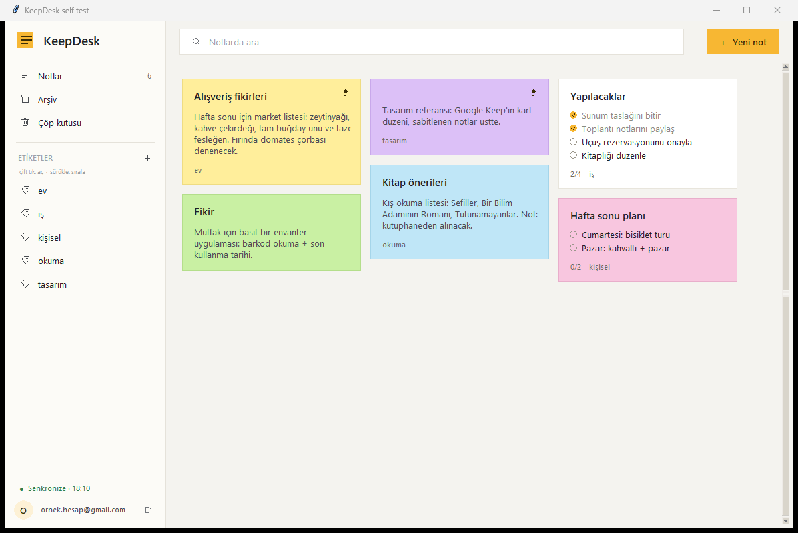
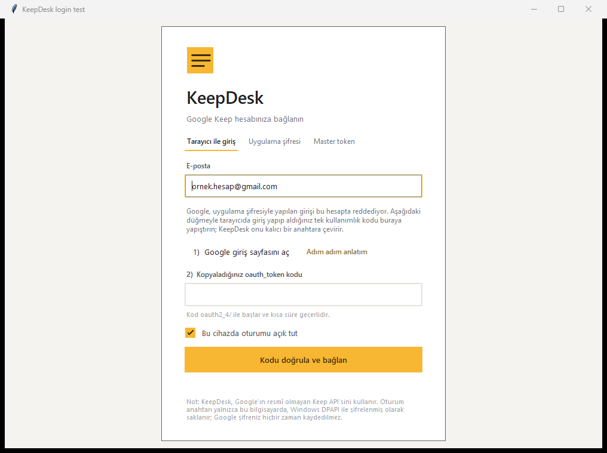
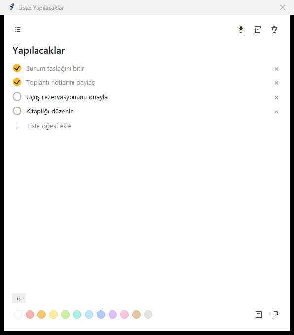

# KeepDesk

Google Keep notlarınızı Windows'ta yönetmek için küçük, hızlı bir masaüstü
uygulaması. Tek dosyalık `KeepDesk.exe` olarak çalışır; kurulum gerektirmez.

> **Önemli:** Google Keep'in kişisel hesaplar için resmî bir API'si yoktur.
> KeepDesk, Keep'in Android/web istemcisinin kullandığı uç noktaları konuşan
> açık kaynak [gkeepapi](https://github.com/kiwiz/gkeepapi) kütüphanesini
> kullanır. Google, normal hesap şifresiyle girişe izin vermez; bu yüzden
> birincil yol **tarayıcıdan alınan tek kullanımlık kod**dur.



<details>
<summary>Diğer ekran görüntüleri</summary>





</details>

---

## 1. Çalıştırma

1. `KeepDesk.exe` dosyasını istediğiniz bir klasöre kopyalayın (örn. `C:\Tools\KeepDesk`).
2. Çift tıklayın. İlk açılış, tek dosyalık paketin açılması nedeniyle 2-5 sn sürebilir.
3. Giriş ekranında e-posta adresinizi yazıp **Tarayıcı ile giriş** sekmesini kullanın.

Windows SmartScreen "bilinmeyen yayıncı" uyarısı gösterirse
**Daha fazla bilgi → Yine de çalıştır** seçin (uygulama imzasızdır).

## 2. Giriş: tarayıcı ile (önerilen)

Google, `keep` kapsamlı oturumları yalnızca tarayıcıdan onaylanan akışla veriyor.
Uygulama bunu sizin için şu adımlara indirger:

1. KeepDesk'te **1) Google giriş sayfasını aç** düğmesine basın.
   Tarayıcıda `accounts.google.com/EmbeddedSetup` açılır.
2. Hesabınızla giriş yapın; çıkan ekranda **Kabul ediyorum**'a basın.
   Sonrasında sayfa boş görünebilir — bu normaldir.
3. Adres çubuğundaki **kilit simgesine** tıklayın →
   **Çerezler ve site verileri** → **Yönet** → `accounts.google.com` →
   **oauth_token**.
4. **İçerik** alanındaki değerin tamamını kopyalayın ( `oauth2_4/` ile başlar).
5. KeepDesk'e yapıştırın ve **Kodu doğrula ve bağlan**'a basın.

Kod tek kullanımlıktır ve kısa süre geçerlidir. Hata alırsanız tarayıcıda
sayfayı yenileyip yeni bir kod alın. KeepDesk bu kodu kalıcı bir *master
token*'a çevirir; bir daha bu adımları yapmanız gerekmez.

Uygulama içindeki **Adım adım anlatım** bağlantısı aynı adımları görsellerle
destekleyen bir pencere açar.

<details>
<summary>2b. Alternatif: uygulama şifresi (bazı hesaplarda çalışmaz)</summary>

1. [myaccount.google.com/security](https://myaccount.google.com/security) → **2 Adımlı Doğrulama**'yı açın.
2. [myaccount.google.com/apppasswords](https://myaccount.google.com/apppasswords) → **Diğer (özel ad)** → `KeepDesk` → **Oluştur**.
3. 16 haneli şifreyi **Uygulama şifresi** sekmesine yapıştırın.

Google bu yöntemi giderek daha sık `BadAuthentication` ile reddediyor;
o durumda tarayıcı akışını kullanın.

</details>

<details>
<summary>2c. Alternatif: mevcut master token (<code>aas_et/…</code>)</summary>

Başka bir araçla (gkeepapi/gpsoauth) ürettiğiniz kalıcı anahtarı
**Master token** sekmesine yapıştırabilirsiniz. Anahtar `aas_et/` ile başlar ve
hesabınıza tam erişim verir; kimseyle paylaşmayın.

</details>

## 3. Neler yapabilirsiniz

| Özellik | Nasıl |
|---|---|
| Not oluşturma | Sağ üstteki **＋ Yeni not** veya `Ctrl+N` |
| Kontrol listesi | Not editöründeki liste simgesiyle nota dönüştürün, satır ekleyin/silim |
| Düzenleme | Karta tıklayın; yazdıklarınız otomatik kaydedilir |
| Sabitleme | Kart üzerine gelin → raptiye simgesi |
| Renk | Kartta sağ tık → **Renk** ya da editörün alt şeridi |
| Etiket | Editörde etiket simgesi; kenar çubuğunda **çift tık** ile filtreleyin |
| Etiket sırası | Kenar çubuğunda etiketi **tutup sürükleyin**; sıra bu cihazda hatırlanır |
| Kart sırası | Panoda kartı **tutup başka bir kartın üzerine bırakın** (sol yarı = önüne, sağ yarı = arkasına) |
| Arşiv / Çöp | Kart menüsü veya kenar çubuğu; çöpten geri yükleme ve kalıcı silme |
| Arama | Üstteki arama alanı (`Ctrl+F`), başlık + gövde + liste öğeleri + etiketler |
| Yenileme | `F5` veya hesap menüsü → **Şimdi senkronize et** |

Değişiklikler ~1 saniye içinde sunucuya gönderilir; ayrıca her 60 saniyede
bir otomatik senkronizasyon yapılır.

**Kısayollar:** `Ctrl+N` yeni not · `Ctrl+F` arama · `F5` senkronize ·
`Ctrl+S` (editörde) hemen kaydet · `Esc` editörü kapat.

## 4. Verileriniz nerede?

- Ayarlar ve oturum anahtarı: `%APPDATA%\KeepDesk\settings.json`
- Çevrimdışı önbellek: `%APPDATA%\KeepDesk\cache.json`
- Günlük: `%APPDATA%\KeepDesk\keepdesk.log`

Master token Windows **DPAPI** ile, yalnızca sizin Windows kullanıcı hesabınızın
çözebileceği biçimde şifrelenir. "Bu cihazda oturumu açık tut" işaretini
kaldırırsanız anahtar diske hiç yazılmaz. **Çıkış yap** dediğinizde kayıtlı
anahtar silinir.

## 5. Sorun giderme

| Belirti | Çözüm |
|---|---|
| "E-posta veya uygulama şifresi kabul edilmedi" | Uygulama şifresini yeniden oluşturun; normal şifre değil, 16 haneli şifre girilmelidir |
| "Google bu giriş için tarayıcı doğrulaması istedi" | Hesapta 2 Adımlı Doğrulama'yı açıp uygulama şifresi kullanın |
| "Google'a bağlanılamadı" | İnternet, güvenlik duvarı, proxy/VPN; kurumsal cihazlarda TLS denetimi engelliyor olabilir |
| Notlar gelmiyor | Soldaki durum yazısına bakın; `F5`; hesap menüsünden çıkıp yeniden giriş |
| Uygulama açılmıyor | `%APPDATA%\KeepDesk\keepdesk.log` dosyasındaki son satırlara bakın |
| Antivirüs uyarısı | İmzasız PyInstaller paketi; istisna ekleyin veya kaynaktan çalıştırın |

## 6. Sınırlamalar

- Google'ın resmî olmayan API'si kullanıldığı için Google tarafında bir
  değişiklik olduğunda giriş/senkronizasyon geçici olarak bozulabilir.
- Hatırlatıcılar, görsel/çizim ekleri ve paylaşılan notların ortak düzenlemesi
  desteklenmez.
- Aynı anda birden çok cihazda düzenleme yaparken son yazan kazanır
  (Keep'in kendi davranışı).

## 7. Kaynaktan çalıştırma / yeniden derleme

```powershell
# 1) Bağımlılıkları yerel klasöre indir (pip gerekmez)
python tools\fetch_deps.py --target vendor gkeepapi
python tools\fetch_deps.py --target vendor_build pyinstaller

# 2) Geliştirme modunda çalıştır
python run.py

# 3) Tek dosyalık exe üret
$env:PYTHONPATH = "$PWD\vendor_build"
python -m PyInstaller --noconfirm --distpath dist --workpath build KeepDesk.spec
```

Gereksinim: Windows 10/11, Python 3.14 (tkinter dahil). Simgeyi yeniden
üretmek için `python tools\make_icon.py`.

## 8. Proje yapısı

```
app/
  main.py        uygulama girişi, ekran geçişleri, DPI/ikon
  service.py     gkeepapi etrafında iş parçacığı güvenli katman
  store.py       ayarlar + DPAPI ile şifreli token
  paths.py       %APPDATA% / paket yolları (yazılamazsa geri düşer)
  theme.py       renkler, yazı tipleri, ttk stilleri
  ui/            login, ana pano, not editörü, ikonlar, widget'lar
assets/          icon.ico, ca-bundle.pem
tools/           bağımlılık indirici, ikon üretici, görsel test betikleri
```
